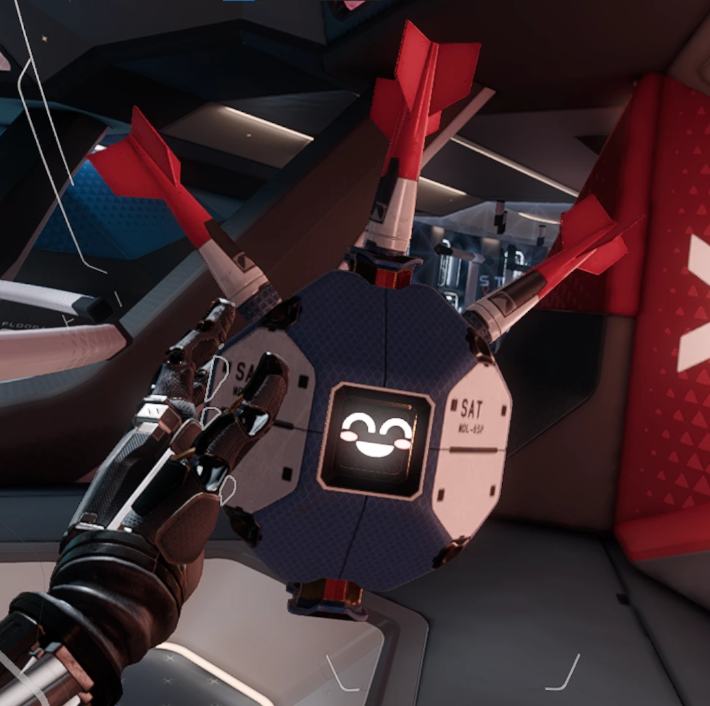
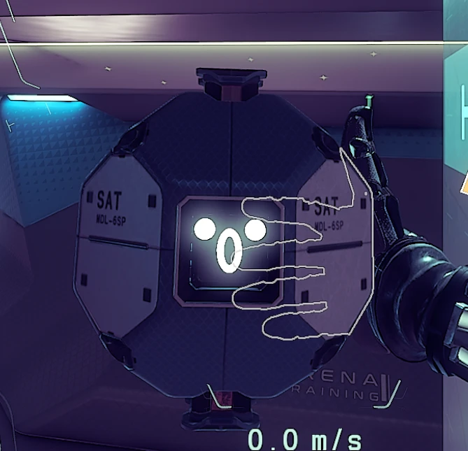
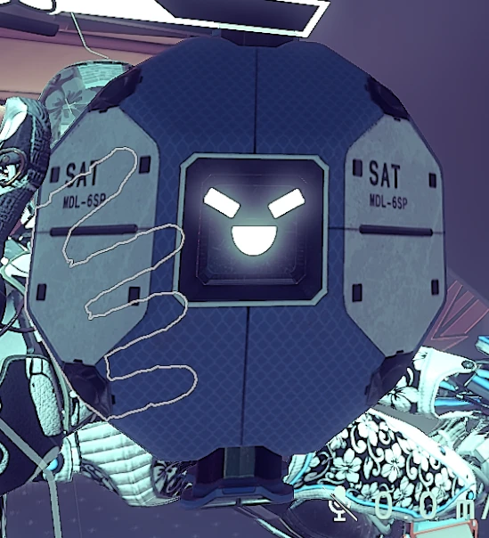

# E.D.I.T.H

**E**ven **D**ead **I**'m **T**he **H**ero: a joke from *Spider-Man: Far From Home*.

The Christmas CubeSat brought back into Echo VR's live lobby as **E.D.I.T.H**, "the new AI for the
Echo Construct": she flies, follows, tumbles, stares, throws balls at people who throw her, shoves and
shuts down bullies, changes face with her mood, and talks (her brain runs on SparkAPI; see `docs/`).
One Edith per match: players with the mod share her through the relay (`docs/networkplan.md`).

| Happy | Surprised | Angry |
|:---:|:---:|:---:|
|  |  |  |

## Layout

| Path | What |
|---|---|
| `plugin/` | `EDITH.dll`: her behaviour (`satellite.cpp`), the relay client (`edith_net.cpp`), her lobby data from `.edith` packages (`edith_pack.cpp`) |
| `ai/` | her ears and voice (`edith_ears.py`, the companion that talks to her brain), the old local companion, her library, voice rendering |
| `tools/` | level build (`build_satellite.py`), her `.edith` package (`make_edith_pack.py`), faces, textures (`retexture.py`), voice pack, release (`make_release.py`) |
| `release/` | `install.bat`, `uninstall.bat`, the player README; `E.D.I.T.H-<version>.zip` is built here |
| `docs/` | plans: networking, her brain, the original satellite rules |
| `agent.md` | the working notes: every finding, address and decision, by session |

## Build

```bat
build_satellite_plugin.bat
python tools\build_satellite.py --name mpl_lobby_b2 --her-model --with-port --port-faces --at 0 2.3 0
python tools\make_edith_pack.py
python tools\make_release.py
```

`out/` (build output) and the release zip are not in git.
